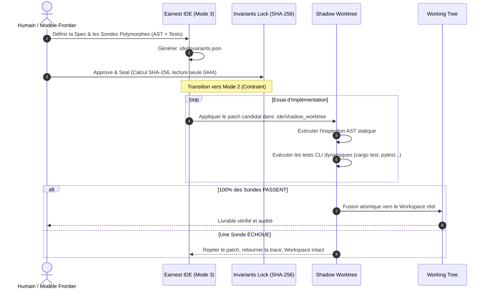

# EARNEST

<p align="center">
  <strong>E</strong>xperience-driven <strong>A</strong>gentic <strong>R</strong>untime & <strong>N</strong>ested <strong>E</strong>ngineering with <strong>S</strong>ealed <strong>T</strong>ruths
</p>

<p align="center">
  <em>L'IDE & Système d'Exploitation Agentique Vérifiable : Gouvernance Spec-First, Invariants Scellés Cryptographiquement et Arbitrage par Shadow Worktree.</em>
</p>

<p align="center">
  <a href="https://github.com/lecyberbill/Ernest/actions/workflows/ci.yml">
    
  </a>
  
  
  
  
  
  
</p>

---

## 💡 Le Problème Fondamental : Pourquoi le Coding Agentique Dérive

Les agents de code IA modernes (Copilot, Cursor, agents CLI autonomes) souffrent d'un défaut structurel : **la dérive stochastique et la mutation non contrôlée des fichiers**.

Lorsqu'un LLM écrit directement dans votre arbre de travail :
1. Il modifie des fichiers sans garantie mathématique.
2. Il casse des cas limites existants et altère silencieusement les interfaces.
3. Il s'auto-valide par des confirmations superficielles sans vérification formelle de contrat.

**EARNEST change de paradigme :** un agent ne doit **jamais** écrire directement dans l'espace de travail principal. L'évolution logicielle doit suivre un **cycle de preuve formelle** appuyé sur des invariants cryptographiques et des git worktrees isolés.

---

## 🏛️ Architecture : La Triade EARNEST

EARNEST repose sur trois piliers modulaires qui se renforcent mutuellement :

```
                  ┌────────────────────────────────────────┐
                  │           EARNEST ECOSYSTEM            │
                  └──────────────────┬─────────────────────┘
                                     │
         ┌───────────────────────────┼───────────────────────────┐
         │                           │                           │
         ▼                           ▼                           ▼
┌──────────────────┐       ┌──────────────────┐       ┌──────────────────┐
│   EARNEST IDE    │◄─────►│   EARNEST CORE   │◄─────►│   EARNEST BCPE   │
│ (Governance UI)  │  MCP  │ (Agent Runtime)  │  RAG  │ (Experience KB)  │
└──────────────────┘       └──────────────────┘       └──────────────────┘
         │                           │                           │
  - Spec-First / Modes        - Boucle ReAct              - Retours d'essais
  - Invariants Scellés        - Shadow Worktree           - Heuristiques & Fix
  - Coupe-circuit Humain      - Arbitre Cryptographique   - Déduplication
```

### 1. 🛡️ EARNEST IDE (`earnest-ide`)
Un cockpit bureau & web dédié à la gouvernance agentique :
- **Cycle Spec-First** : impose une transition explicite du **Mode 3 (Architecture & Invariants)** vers le **Mode 2 (Implémentation Contrainte)** et le **Mode 1 (Libre / Humain)**.
- **Scellement Cryptographique des Invariants** : les invariants sont hachés (`SHA-256`) et verrouillés dans `.ide/invariants.lock` en lecture seule (`0o444`). Ni l'agent ni un processus non autorisé ne peut altérer le contrat sans validation humaine explicite.
- **Arbitrage par Shadow Worktree** : le code candidat est patché et exécuté dans un git worktree isolé (`.ide/shadow_worktree`). Ce n'est que lorsque **100 % des sondes polymorphes (AST statique + tests CLI dynamiques)** PASSENT que le patch est fusionné atomiquement dans l'arbre de travail.

### 2. ⚡ EARNEST Core & OS (`earnest-core` / `earnest`)
Le moteur d'exécution agentique souverain :
- **MCP-Native (Model Context Protocol)** : expose 14+ outils standardisés sur stdio/HTTP (`earnest-ide-core --mcp --workspace <path>`), permettant à n'importe quel modèle Frontier (Claude, GPT, Gemini) de jouer le rôle d'architecte tout en déléguant l'exécution à des modèles locaux spécialisés.
- **Moteur ReAct** : boucle native rapide avec comptabilité stricte des tokens, persistance des outils enregistrés et délégation au planificateur de l'OS (aucun daemon arrière-plan non contrôlé).
- **UI Vanilla Zéro-Build** : composants Web ultra-légers + Monaco Editor propulsés par Tauri v2.

### 3. 🧠 EARNEST BCPE (`earnest-bcpe`)
La Base de Connaissances d'Expérience :
- **Apprentissage Continu par l'Expérience** : stocke les incidents, modes d'échec et modèles de sondes validés dans une base SQLite/RAG embarquée (`kb.db`).
- **Anti-boucle & Mémoire** : dès la phase de conception Mode 3 ou en Mode 1/2, l'agent interroge (`kb_list_products`, `kb_search`) les incidents réels précédents pour éviter de reproduire des erreurs connues.

---

## 🔄 Le Workflow de Gouvernance en 4 Étapes



---

## 🚀 Démarrage Rapide

### Prérequis
- **Rust** : `1.80+` (édition 2021/2024, `cargo`)
- **Python** : `3.11+` (`pytest` pour les tests agentiques)
- **Git** : installé et accessible dans le `PATH`

### 1. Cloner le dépôt
```bash
git clone https://github.com/lecyberbill/Ernest.git
cd Ernest
```

### 2. Valider les Invariants du Cockpit & du Core
Vérifier que les 10 invariants architecturaux sont strictement respectés :
```bash
python tests/validate_invariants.py
```
```text
=== Validating 10 Architectural Invariants ===
[INV-01-SCHEMA-SQLITE] ... OK [PASS]
[INV-02-NO-DAEMON] ... OK [PASS]
[INV-03-CORE-TOOLS-SCHEMA] ... OK [PASS]
[INV-04-STORE-RECALL-MEMORY-ISOLATION] ... OK [PASS]
[INV-05-SANDBOX-EXECUTION] ... OK [PASS]
[INV-06-REGISTER-TOOL-PERSISTENCE] ... OK [PASS]
[INV-07-EXPLICIT-FAILURE] ... OK [PASS]
[INV-08-NO-UNAUTHORIZED-EXTERNAL-PROCESS] ... OK [PASS]
[INV-09-ZERO-BUILD-VANILLA-UI] ... OK [PASS]
[INV-10-OS-SCHEDULER-DELEGATION] ... OK [PASS]

ALL 10 INVARIANTS ARE 100% RESPECTED & COMPLIANT!
```

### 3. Lancer les Tests Unitaires
```bash
pytest tests/
```

### 4. Compiler et Lancer EARNEST IDE Core (Serveur MCP)
```bash
cd earnest-ide/core
cargo run --release -- --mcp --workspace /path/to/project
```

### 5. Brancher EARNEST dans Claude Desktop / Antigravity / Tout Client MCP
Ajoutez EARNEST à la configuration de votre client MCP (`claude_desktop_config.json` ou `mcp_config.json`) :
```json
{
  "mcpServers": {
    "earnest-ide": {
      "command": "/path/to/Ernest/earnest-ide/core/target/release/earnest-ide-core.exe",
      "args": ["--mcp", "--workspace", "/path/to/your/project"]
    }
  }
}
```

---

## 📂 Structure du Dépôt

```text
Ernest/
├── crates/                     # Crates Rust pures sans dépendances (atomic-patch, symbol-index, loop-detector, tool-guard, token-compactor, agent-scheduler, log-sanitizer, context-trimmer, tool-output-cache, retry-budget, json-repair, kv-wal-engine, stream-cleaner)
├── earnest/                    # Core Python : runtime agentique, outils, DB & télémétrie
├── earnest-core/               # Moteur Rust natif : boucle ReAct, streaming SSE, serveur & WFL
├── earnest-ide/                # IDE de Gouvernance
│   ├── core/                   # Backend Rust : serveur MCP, Shadow Worktree, Invariants, LSP
│   ├── src-tauri/              # Wrapper desktop (Tauri v2)
│   └── ui/                     # Cockpit UI Vanilla ES Modules + Monaco Editor
├── earnest-bcpe/               # Base de Connaissances d'Expérience (RAG & mémoire d'incidents)
├── earnest-wf-engine/          # Moteur de workflows déterministes WFL (wf-core, wf-mcp, wf-ui)
├── ui/                         # Cockpit Centre d'Opérations (Web Components Vanilla + Studio WFL)
├── tests/                      # Suites de tests formels & harnais de vérification d'invariants
└── .ide/                       # Politique de gouvernance et invariants du projet
```

### 🎛️ Points Clés du Centre d'Opérations (Cockpit) & de l'IDE
- **Streaming SSE Temps Réel & Annulation** : événements ReAct en direct (`GET /api/runs/{id}/stream`) avec annulation coopérative immédiate (`POST /api/runs/{id}/cancel`).
- **Modèles Dynamiques & Fenêtre de Contexte** : découverte automatique des modèles locaux/cloud (`/api/providers/models`), affichage du contexte actif et gestion de `max_steps=0` (illimité) avec protection anti-boucle.
- **Pipelines Multi-Agents, Studio WFL & Logs** : orchestration Architect → Dev → QA, **Studio Visuel WFL 3 panneaux type Fortra Automate** (`workflow-studio.js` avec 17 actions, branches `Then/Else` & `For Each`, synchronisation bidirectionnelle Visuel ↔ YAML, `/api/workflows/detail|validate|save`), journaux structurés en direct et prévisualisation d'artefacts HTML sandboxée.
- **Chat Interactif & Nettoyage de Flux** : rendu Markdown sécurisé (`stream-cleaner` séparant `<thought>`/`<think>`), statut animé et synthèse vocale **Read / Stop**.
- **Gouvernance IDE & Sécurité** : `project-integrity-gate` polyglotte (`cargo test` + `cargo clippy -D warnings` pour Rust) avant fusion du Shadow Worktree, outils sandbox (`shadow_check`, `shadow_copy`, `shadow_validate_and_merge`, `read_file` sensible au shadow), schéma plat `add_invariant`, `loop-detector`, points de restauration Git **Time-Travel** (`/api/ide/checkpoint/restore`), `symbol_search` + `workspace_map` (`symbol-index`), `atomic-patch`, masquage des secrets (`log-sanitizer`), `EARNEST_OLLAMA_NUM_CTX` configurable, et **client LSP générique JSON-RPC 2.0** avec diagnostics en direct (`setModelMarkers`) et catalogue auto-installable 12 langages (`/api/ide/lsp/*`).
- **Protocole MCP BCPE (`earnest-bcpe`)** : intégré dans `earnest-ide` et `earnest-core` (`kb_list_products`, `kb_search`, `kb_propose` avec résolution unifiée `resolve_kb_db_path()`), plus création manuelle de produits, filtres et suppression d'entrées dans l'UI (`/api/ide/kb/*`).

---

## 🔒 Garanties de Sécurité & Vérification

- **Invariants Infalsifiables** : toute modification de `.ide/invariants.json` invalide le sceau SHA-256 stocké dans `.ide/invariants.lock`, bloquant immédiatement les écritures jusqu'à ré-approbation humaine.
- **Sandbox Zéro-Pollution** : l'arbre de travail principal n'est jamais touché pendant les essais ; les artefacts de build et échecs restent isolés dans les worktrees détachés.
- **Souveraineté Locale** : les identifiants et clés API utilisent le chiffrement local de l'OS (Windows DPAPI / secrets locaux), sans dépendance propriétaire obligatoire.

---

## 🏆 Vitrine : `kv-wal-engine` Construit Sous Gouvernance Stricte

Pour éprouver Earnest IDE de zéro, nous avons demandé à **Earnest Copilote** de construire un **moteur Key-Value transactionnel crash-safe en Rust pur** (`kv-wal-engine`, zéro dépendance externe) sous contraintes serrées (compaction à 36k caractères et checkpoints ReAct à 30 étapes, forçant l'agent à s'appuyer sur `.ide/invariants.json` et la vérité disque) :

- **Prompt de base** :
  > *"Build a transactional key-value storage engine in Rust (`kv-wal-engine`) with a binary CRC32 WAL + `fsync`, ACID transactions with Snapshot Isolation (MVCC + `WriteConflict`), atomic compaction (`.tmp` + `rename` + WAL truncation), and crash-recovery tests."*
- **Flux Mode 3 → Mode 2** :
  1. **Mode 3 (`architecture`)** : Earnest Copilote a conçu 5 modules (`wal.rs`, `engine.rs`, `mvcc.rs`, `snapshot.rs`, `lib.rs`) et scellé **10 contrats (`C1`–`C10`)** dans `.ide/invariants.json` + `.ide/invariants.lock` (SHA-256).
  2. **Mode 2 (`constrained`)** : chaque patch a été compilé et vérifié dans `.ide/shadow_worktree/` avant promotion vers le workspace.
- **Résultats vérifiés** :
  - **`cargo test --all-targets`** : **23/23 tests passés** (`wal_format`, `crash_recovery` à chaque offset d'octet, `mvcc_conflict`, `compaction_restart`).
  - **`cargo clippy --all-targets -- -D warnings`** : **0 warning, 0 erreur**.
  - **Test de charge E2E** : `1 301` opérations WAL durables avec `fsync` en **430 ms**, crash simulé + compaction atomique de snapshot en **21 ms**, 100 % des données vérifiées après redémarrage complet.
  - **Dogfooding** : `kv-wal-engine` est intégré dans `earnest-ide-core` (`/api/ide/kv_state`) pour la persistance d'état crash-safe de l'IDE.

---

## 📄 Licence

Double licence au choix :
- [Apache License, Version 2.0](LICENSE-APACHE)
- [MIT License](LICENSE-MIT)

---

## Benchmarks & Stress-Tests (Qwen 3.8 Local)
- [Context Trimmer](docs/BENCHMARK_QWEN38_CONTEXT_TRIMMER.md) — Troncature bornée des sorties d'outils & compaction d'historique
- [Tool Output Cache](docs/BENCHMARK_QWEN38_TOOL_OUTPUT_CACHE.md) — Cache LRU zéro-dépendance avec invalidation par chemin
- [Retry Budget](docs/BENCHMARK_QWEN38_RETRY_BUDGET.md) — Budget de retries à fenêtre glissante & coupe-circuit
- [Stream Cleaner](docs/BENCHMARK_QWEN38_STREAM_CLEANER.md) — Automate de séparation streaming `<thought>` / `<think>` (`crates/stream-cleaner`)
